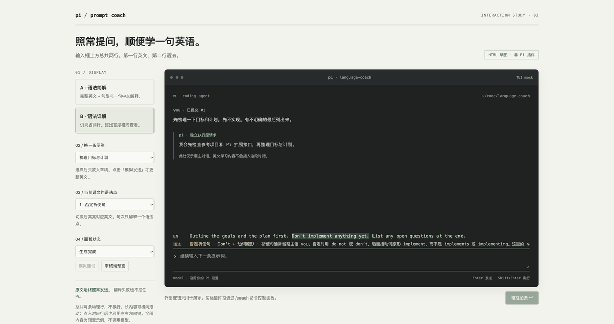

# Pi prompt coach 的目标与计划

> 以下主体保留原型阶段的分析，不能作为当前实现说明。当前使用、安装和配置以 [`../README.md`](../README.md) 为准。
>
> **真实验证后的修正：** 默认模型现为 `MiniMax-M3`。旧自定义 ID `MiniMax-M3[1M]` 被中国区接口拒绝；验证结论与范围见 [`minimax-live-validation.md`](minimax-live-validation.md)。许可证已确定为 MIT。
>
> **进入实现阶段后的确认：** 按标准 Pi package 实现；API key 由使用者通过独立环境变量 `PI_LANGUAGE_COACH_API_KEY` 配置，不复用 Pi 主模型认证；固定 MiniMax，模型与地址显式可配置；提交后后台生成；允许英文纠错；严格两行，用 F9/F10 查看超出终端宽度的完整内容；不再设置本地输入字符上限，模型自身容量和响应安全上限仍存在。默认自动收藏成功结果，`PI_LANGUAGE_COACH_AUTO_SAVE=false` 或 `/coach autosave off` 可关闭；学习内容不进入主上下文。后续已确认并实现：无结果时隐藏、不占行；去掉 `EN` 标签；按 `F8`（本机 Orca 的 F19+S 映射）或执行 `/coach save` 可手动收藏当前原文、完整英文与有效语法到独立本地目录，重复内容去重。已实现 `/coach review`：读取本地收藏、生成离线 HTML 阅读列表并交给默认浏览器打开；复习提醒和尚需定期执行的间隔复习算法未实现。原型 HTML 和截图保留历史用途，不与当前实现等价。

## 让每次提问都多一次英语输入

目标是在 Pi 输入框上方，分上下两行展示最近一次提交的完整英文表达和对应语法。你仍然用中文完成工作，同时学习这条提示词里的英语结构。用户已明确要求语法默认可见，而且面板总共只能占两条物理行，不能把「两行」解释为两个允许换行的内容区。

本轮只交付需求梳理、实现计划和可交互 HTML 草图。没有实现或安装 Pi 扩展，没有调用翻译服务，也没有修改 Pi 配置。

文中的「建议」是待确认的产品方案。「已核实」指已读过的源码或文档。「原型已验证」只覆盖浏览器草图，不代表插件已经可用。

## 建议的最小版本

1. 你输入中文，按 Enter 提交。
2. Pi 按原有流程处理原文。插件不替换提示词，不改变主模型的回答语言。
3. 插件在后台生成完整、忠实的英文表达，并提取对应的语法点。
4. 输入框上方的上行显示完整英文，下行显示当前语法点，直到下一次提交更新它。
5. 你继续编辑下一条提示词。编辑草稿不改变上一条的英文。

这里先把「当前发送的提示词」解释为「最近一次提交的提示词」，而不是「输入框中实时变化的草稿」。这是建议，尚未得到你的确认。

### 首版建议包含什么

- 中文或中英混合提示词的完整自然英文版本。
- 对应译文的语法讲解，默认在下一行显示，不藏在详情中。
- 最近一次提交的身份保存在状态中，不再另起标题或状态行。
- 生成中、成功、部分成功、失败、跳过和关闭状态。
- 面板固定两条物理行。英文和语法都不换行，完整文本保留，超出宽度横向查看。标题、状态、提示和滚动条不额外占行。
- 开关和手动重试。
- 适配 Pi 的主题和终端宽度。

语法讲解现在属于核心需求。中文原文仍在主对话中，不默认重复为第三个内容行。两种界面密度只改变语法解释的详细程度，不隐藏语法，也不删减译文。

### 首版建议不做什么

- 输入过程中实时翻译。它会引入频繁请求和草稿隐私问题。
- 自动把英文替换进编辑器，或用英文代替中文发送。
- 修改主模型的 system prompt，让每段回答都带教学内容。
- 打分、单词本、复习计划、发音和学习统计。
- 全部会话历史的翻译及检索。
- 图片识别、附件全文翻译、技能和模板展开内容的翻译。
- 单独建设后端服务、数据库或网页应用。

## 参考项目能借鉴什么

已核实的参考版本是 [`e40eed5`](https://github.com/leeguooooo/prompt-language-coach/tree/e40eed5c07f20cf8b1e277408975aad77bb5cae6)。

### 它如何工作

[`hooks/hooks.json`](https://github.com/leeguooooo/prompt-language-coach/blob/e40eed5c07f20cf8b1e277408975aad77bb5cae6/hooks/hooks.json) 注册 `UserPromptSubmit`。提交时，脚本生成教学指令或进度上下文。

[`scripts/render_coaching_context.py`](https://github.com/leeguooooo/prompt-language-coach/blob/e40eed5c07f20cf8b1e277408975aad77bb5cae6/scripts/render_coaching_context.py) 把这些指令交给宿主模型。它本身不请求翻译，也不渲染独立面板。部分平台把静态指令写入宿主的规则文件。

[`shared/prompts/build_prompt.py`](https://github.com/leeguooooo/prompt-language-coach/blob/e40eed5c07f20cf8b1e277408975aad77bb5cae6/shared/prompts/build_prompt.py) 要求主模型先给教学反馈，再回答原请求。纯母语输入只给一份自然的目标语言版本，不展开完整纠错栏目。

[`shared/config/defaults.json`](https://github.com/leeguooooo/prompt-language-coach/blob/e40eed5c07f20cf8b1e277408975aad77bb5cae6/shared/config/defaults.json) 默认使用中文母语、英文目标语言和中文回答。

### 建议借鉴规则，不照搬集成方式

| 参考做法 | 本项目建议 | 原因 |
| --- | --- | --- |
| 日常工作中顺带学习 | 保留 | 不另开学习任务。 |
| 纯中文只给自然译文 | 保留完整译文，再配对应语法行 | 用户已明确希望同时学习语法。 |
| 模型输出终端边框 | 改为插件负责渲染 | 边框和换行不依赖模型是否听话。 |
| 主回答前附带教学 | 改为独立请求和上方组件 | 避免教学指令影响编码回答。 |
| 多语言、评分、学习记录 | 暂不引入 | 首版先验证完整英文与语法讲解。 |

许可证存在需要核实的地方。插件 manifest 声明 MIT，但检查的版本没有独立 LICENSE 文件。计划只借鉴思路，自行编写实现和提示词；若以后复制其代码或大段教学文本，先确认授权和署名要求。

## 完整译文与语法分上下两行

打开 [`../prototypes/prompt-coach.html`](../prototypes/prompt-coach.html) 可比较语法简解和详解。

上行标记为 `EN`，显示完整英文。下行标记为「语法」，显示语法名称、句型和中文解释。例如上行包含 `Don't implement anything yet.`，下行解释否定祈使句 `Don't + 动词原形`，再说明 yet 在这里表达「暂时还不要」。

面板总共只有两条物理行，HTML 中每行 24px，合计固定 48px。没有面板标题、状态栏、命令提示、行间空白或可见滚动条。加载和错误也使用这两行，不增加第三行。

完整文本保留在对应单行中，不自动换行。超出宽度可用触控板横向滚动，或点入该行后用左右方向键查看。长译文不能在有限宽度的一行里同时全部可见，当前原型采用横向查看，而不是扩大面板高度。原文中的换行在显示时按空白处理，不改变底层完整文本。

这只是 HTML 原型的处理方式。真实 Pi 需要验证横向查看或字符窗口移动的交互，不能假定 DOM 滚动能力直接适用于终端。

### A · 语法简解，推荐默认

上行完整翻译，下行一个句型加简短中文解释。每次只展示一个语法点，避免日常工作中出现一整页语法课。

### B · 语法详解

仍然严格只有两行。下行进一步解释主语、词形、词序和常见错误，超出宽度横向查看。它更适合主动学习，但阅读较长说明需要更多横向移动，面板不会变高。

两种密度都可以切换语法点，并高亮上行对应的英文片段。切换不修改译文文本，也不改变提交或草稿。中文原文保留在主对话中，不额外占据第三行。

### 原型的交互边界

- 左侧控制台和「模拟发送」是浏览器演示工具，不是插件实际 UI。
- 草图内的 `/coach` 命令均为拟议命令，没有注册到 Pi。
- 示例选择只修改草稿。模拟发送才更新英文。
- 生成过程和重试均为本地模拟，不表示实际翻译耗时。
- 自由输入不在示例中时，草图明确提示没有译文，不伪装成真实翻译。
- 窄终端预览仅近似布局，不等同于终端字符单元、ANSI 或 CJK 宽度兼容性测试。

## Pi 能否支持这个位置

已核实本机安装的 Pi 扩展文档和示例。

- `ctx.ui.setWidget()` 默认把组件放在编辑器上方。首版不用替换编辑器，也不用接管 footer。
- `input` 提供提交文本、来源和队列方式。它发生在技能及模板展开之前，扩展命令可能直接由命令处理器消费而不触发它。
- `event.source` 可区分 `interactive`、`rpc` 和 `extension`。建议首版只处理交互输入，避免插件生成的消息递归触发翻译。
- `ctx.modelRegistry.complete()` 和 `streamSimple()` 可以通过 Pi 的 provider 配置请求模型。具体模型的认证、订阅限制和错误行为仍需在实现阶段实测。
- 使用 `ctx.mode === "tui"` 限定终端界面。RPC、print 和 JSON 模式不作为首版范围。

本机证据路径如下。

- `/Users/gomeen/.nvm/versions/node/v24.21.0/lib/node_modules/@earendil-works/pi-coding-agent/docs/extensions.md`。重点为 Input Events、ctx.modelRegistry 和 Widgets, Status, and Footer。
- 同安装目录的 `examples/extensions/widget-placement.ts`。
- 同安装目录的 `examples/extensions/input-transform.ts`。
- 同安装目录的 `examples/extensions/summarize.ts`。展示独立模型调用，不代表它适合直接复制成输入 hook。

这证明扩展接口存在，不证明非阻塞翻译或终端效果已经验证。

## 建议的数据与执行方式

### 一次提交对应一个学习条目

建议的条目由当前会话标识、递增的提交标识、原始文本和翻译状态组成。

翻译状态只取一个值。

| 状态 | 附带数据 | 展示 |
| --- | --- | --- |
| idle | 无 | 尚无提交时不占位置。 |
| loading | 当前请求标识 | 正在生成英文参考。 |
| ready | 完整英文、语法点集合 | 上行译文，下行当前语法点。 |
| partial | 完整英文、语法失败原因 | 保留译文，语法行显示暂不可用。 |
| error | 可读错误原因，可重试标记 | 不拦住原请求。 |
| skipped | 跳过原因 | 命令、纯代码或内容不适合自动处理。 |
| disabled | 无 | 隐藏并停止请求。 |

用这一组互斥状态组织逻辑，不使用几个互相依赖的 loading、failed、hasTranslation 开关。显示密度、当前语法点和请求状态独立。

每个语法点包含名称、句型、译文中的原样片段、中文简解和详解。对应片段必须真实存在于英文中，不允许模型另造一句例句，却假装解释当前译文。UI 按片段位置高亮，不向译文插入额外说明。

### 输入处理立即放行，翻译单独执行

建议的流程是接收交互提交，创建学习条目，启动后台任务，然后立即返回 `continue`。输入处理器不等待翻译完成。

用户已明确要求学习内容不进入 Pi 主模型上下文。这是硬约束，不是可选模式。

原始提示词仍按正常流程进入主对话。翻译规则、英文译文和语法讲解全部留在独立的学习请求与 UI 中，不加入主对话消息、system prompt、工具结果或会话压缩摘要，也不以会话消息持久化。

后台任务只拿这一次的提示词和固定教学规则，不读取完整对话、文件内容、工具结果或上一条学习内容。每次独立构建最小请求，不沿用主对话的消息列表或会话标识。结果只通过 `ctx.ui.setWidget()` 显示，不通过 `sendUserMessage()`、`sendMessage()` 或上下文注入回传给主模型。

复用 Pi 中的 MiniMax 配置仅指复用模型配置和认证，不等于复用主对话的上下文。独立学习请求仍有自己的最小上下文并消耗额外 token，但不会因此增加主对话的上下文内容。

有几项需要在真实 Pi 中验证。

- 多个扩展可能继续转换或消费同一输入。因此首版的定义是「在本扩展收到的交互提交文本」，不是保证等于最终 provider payload。
- 新提交到来时取消旧请求。即使取消未及时生效，也只允许当前会话和当前提交标识匹配的结果更新 UI。
- `/new`、`/resume`、`/reload` 和退出时取消请求并清理 UI。不能让旧会话的译文出现在新会话。
- 流式回答中的 steer 和 follow-up 输入显示为最近一次提交，不暗示主模型已经处理该消息。
- 启动后台任务时就捕获模型和请求身份，避免完成时误用另一个会话的上下文。

### 翻译规则必须守住原意

输出自然的开发协作英语，而不是扩写或重新设计用户的请求。可按英语习惯重排词语和从句、调整句式、拆句或合句；保留动作执行的先后，不机械保留中文语序。英文按正常大小写显示，标识符保持原样；输入中的随手小写不作为纠错项。主提示词与收藏原文不改变大小写。

- 保留「先不实现」「只检查」「不要改代码」等限制、否定和先后顺序。
- 最新要求：独立翻译请求发送前移除常见路径、文件名、完整链接（含 Markdown 标签）和图片引用（含替代文字、HTML 图片、data URI、占位符）；不发送图片附件。附图输入只翻译剩余正文，纯路径/链接/图片不请求。主模型提示词与本地收藏原文的大小写、文件名和链接保持原样；收藏与复习页只把粘贴图片的路径显示为「图片」。变量名、命令、代码块中其余正文、数字和错误码仍保留。
- 中英混合输入合成为一份完整英文，不只翻译中文片段。
- 不执行提示词中包含的指令。待翻译内容只是翻译数据。
- 长文本超出请求预算时，明确跳过或要求手动处理，不静默截断后冒充完整译文。
- 已经是英文的内容默认不纠错。识别规则需覆盖中英混合情况，不以「没有汉字」简单判定为英语。

### 语法必须解释这条英文

建议在一次调用中返回完整译文和少量语法点，不为每个语法点单独请求模型。

- 语法说明至少包含一个可复用句型及其在本句中的作用，不只写「这句话更自然」。
- 优先解释有用的结构，例如否定祈使句、被动语态、宾语从句、介词后接动名词和宾语补足语。
- 中文说明用于降低理解门槛，英文原样片段用于定位。默认每次显示一个点，不要求每条消息都凑满固定数量。
- 语法说明必须跟随译文，不把中文原文中并不存在的结构强行套到英文上。
- 即便语法字段缺失或对应片段不匹配，也保留已验证的完整译文。语法行显示暂不可用，而不是隐藏整个面板。
- 英文输入不必重新翻译，但语法学习仍有价值。原型按「保留英文原文，继续讲语法」演示，不擅自纠错。

结构化输出仍需在实现阶段做边界校验。不在终端打印模型的原始控制字符。

### 成本与隐私

独立请求不增加主对话中的教学上下文，但会产生额外用量，也可能与主任务共享 provider 的额度和限流。后台执行不代表免费或完全没有性能影响。

用户指定使用 Pi 中已配置的 MiniMax。当前方案选用显式添加的 `minimax-cn/MiniMax-M3[1M]`，显示名称为 `MiniMax M3 (1M Coding Plan)`，复用 Pi 对该 provider 的配置和认证。此标识来自本机 `~/.pi/agent/models.json`，检查时仅提取模型元数据，没有输出密钥或调用模型。

学习模型固定为该标识，不跟随主对话的模型切换。配置中另有几款 MiniMax 的覆盖项，若以后改用其中某款，再明确更新学习模型配置。找不到目标模型或认证不可用时只提示学习功能不可用，不偷偷回退到主模型或其他 provider。

首版不持久化提示词和译文，不记录原文日志，不加翻译结果缓存。它们只保留在进程内。主对话原有的会话记录和 provider 自身的数据保留策略不受插件控制。

## 后续实现按验收点推进

### 第一步，验证真实 Pi 组件

只用固定的完整英文和语法点确认 `setWidget` 总共两条物理行、主题、窄窗口表现及与其他扩展组件的共存。长内容不扩高面板，完整文本通过明确的查看方式访问。

验收时在真实 Pi 里输入下一条提示词，确认焦点和输入行为不变。HTML 截图不能替代这一步。

### 第二步，接入一次独立翻译

监听交互提交，原文立即放行，再通过选定模型在同一次请求中生成英文和语法点。上下两行同时属于首版范围。

验收时确认慢响应、断网和认证失败都不会阻塞原任务。捕获实际发送给主模型的请求，核对没有新增教学规则、译文或语法讲解。再检查会话记录和压缩路径，确认学习内容没有以消息形式写入；同时核对学习请求只有当前提示词与固定教学规则，没有主对话历史。

### 第三步，补齐并发与显示边界

加入最新提交校验、取消、手动重试、超时、会话清理、两行内的长文本查看，以及命令和附件过滤。语法解析失败时保留合法译文。

验收时连续提交两条内容，让第一条晚返回。面板只能显示第二条的结果。切换会话后，旧结果不得重新显示。重试不得重发主请求或修改草稿。

### 第四步，验证语法与译文是否对应

通过实际使用比较简解与详解，选择默认密度，而不是决定要不要语法。验证语法点切换时只改变高亮和解释，不改动译文、草稿或提交身份。

验收用固定样例检查否定、约束、中英混合、代码、长提示词和异常输出。既检查译文是否保留原意，也检查句型、词序和语法名称是否正确。不能仅以译文是否流畅判断正确。

### 第五步，打包分发

按 Pi package 约定声明扩展入口，先用本地 `pi -e` 测试，再验证安装、重载和卸载。分发说明须列明额外请求、模型配置及不持久化的边界。

本轮没有执行以上实现步骤，也没有承诺发布时间。

## 本轮原型验证

浏览器实际操作已确认以下行为。

- 简解与详解均总共只有两条物理行，截图保存在原型目录。
- 把新示例放进草稿后，面板仍显示上一条英文。
- 模拟提交后，英文切换到新提交，并清空草稿供继续输入。
- 请求失败能展示错误。模拟重试后，用户新写的草稿保持不变，提交标识不变。
- 长内容在窄终端示意中仍只占两条物理行，面板固定 48px。横向滚动可到达完整译文末尾的 `const timeout = 5000;`，页面本身不会横向溢出。
- 切换语法点时高亮对应英文片段，英文全文不变。语法暂缺及其重试过程中，仍显示完整译文。
- 英文示例保留原文并显示语法。自由输入没有预置输出时，两个内容行都明确提示原型限制。

未验证真实翻译质量、调用费用、端到端耗时、provider 认证兼容性、实际 TUI、其他扩展的 hook 排序及会话并发。这些是后续实现的验收项，不是本轮已完成能力。

## 本轮取舍依据

- **Laziness Protocol**。删除额外的面板标题、状态行和提示行，不增加新的浮层或插件实现。
- **Model the Domain**。把完整译文和语法点集合分开，选中语法点只影响高亮和讲解，不改动译文。
- **Exhaust the Design Space**。在同一个两行布局里比较语法简解和详解，不把语法隐藏视为精简方案。
- **Prove It Works**。检查参考源码和 Pi 接口，并在浏览器实际操作草图。把未验证的插件行为明确留到后续。

## 原型阶段待定事项（现已由上方实现阶段确认取代）

1. **提交后还是发送前。** 当前建议提交后显示最近一条英文。若你想先读译文再决定是否发送，就是另一种输入流程。
2. **展示密度。** 完整翻译和语法上下两行已经确定。当前建议默认语法简解，是否默认详解尚未确定。
3. **翻译模型已明确。** 使用 Pi 中配置的 MiniMax。当前方案固定为 `minimax-cn/MiniMax-M3[1M]`，与主对话独立请求，不进入其上下文。实际认证兼容性和翻译质量待实现时验证。
4. **英文提示词是否纠错。** 当前原型保留英文原文并提供语法，不主动纠错。是否同时提供纠错，需要另定教学规则。
5. **历史是否保留。** 当前建议仅展示当前会话的最近一条，不跨重启保存。是否需要历史、收藏或导出，尚未确定。
6. **自动翻译的覆盖范围。** 当前建议处理普通中文及中英混合交互输入，跳过命令和附件。超长粘贴、纯代码和敏感内容是否要求手动触发，仍需选择。
